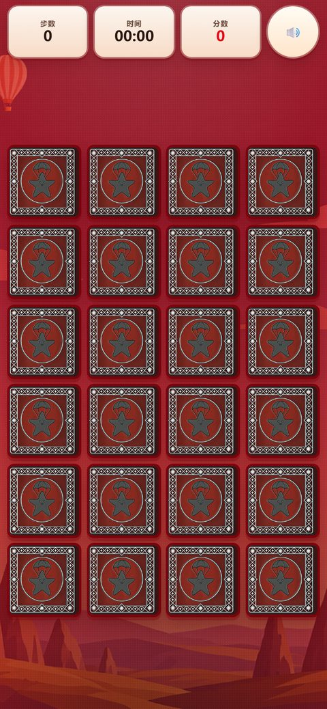
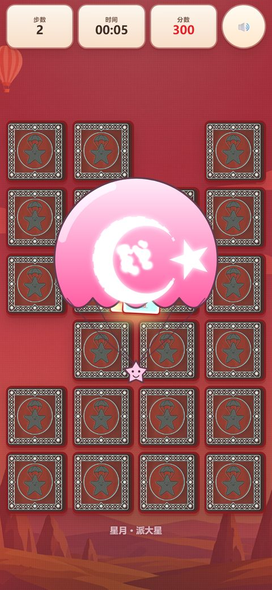
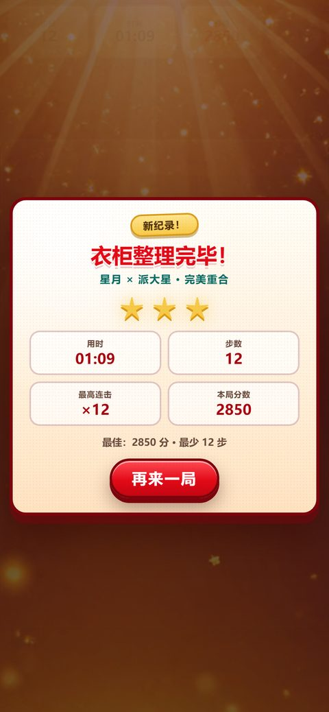
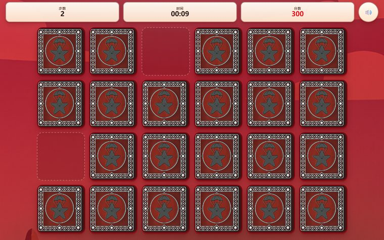

# 派大星的衣柜 · PDT Memory

🎮 **在线玩：https://ghwswywps.github.io/Patrick-Star/**

一个土耳其梗 × 海绵宝宝同人画风的 H5 记忆翻牌游戏。
24 张牌，翻两张，图案相同即消除。**隐藏彩蛋**：翻到「土耳其国旗」+「派大星降落伞」这一对跨类组合时，
两张牌会被吸到一起，触发全屏「星月与派大星完美重合」特效，并额外加分。





横屏 6×4：




## 运行

直接双击 `index.html` 即可（纯前端、零构建、零依赖）。
或者用自带的本地服务器（音视频在 file:// 下更稳）：

```powershell
pwsh -File tools\serve.ps1          # http://127.0.0.1:8080/
pwsh -File tools\serve.ps1 -Port 8099
```

## 玩法

- 24 张牌 = 6 种图案 × 各 4 张 = 12 对：土耳其国旗、派大星降落伞、粉色大裤衩、土耳其烤肉、卡帕多奇亚热气球、派大星憨笑
- 同图案两张 → 消除，连击加分（基础 100 × 连击倍率）
- **国旗 + 降落伞** → 跨类合并，+300 起，并播放全屏重合特效
- 计时 / 步数 / 分数 / 星级评价，最佳成绩存 localStorage（键 `pdt_best_v1`）

## 目录

```
index.html            入口
css/style.css         视觉与响应式
js/flag.js            严格土耳其国旗（矢量几何引擎）
js/engine.js          记忆翻牌逻辑引擎（可 node 直跑）
js/audio.js           BGM / 音效管理
js/merge-effect.js    「星月×派大星」重合特效
js/ui.js              界面外壳与交互
assets/img/cards/     卡牌插画（ComfyUI 千问 2.1 生成）
assets/img/scene/     牌背 / 背景 / 通关背景
assets/img/merge/     特效贴图
assets/flag/          严格国旗 SVG
assets/audio/         BGM 与音效
tools/serve.ps1       本地静态服务器
tools/verify.mjs      自检 harness（node tools/verify.mjs）
docs/CONTRACT.md      团队接口契约
docs/FLAG-SPEC.md     国旗法定几何与出处
docs/ENGINE-NOTES.md  引擎规则与自测
```

## 国旗的严格性

国旗不用 AI 生成（AI 会把月牙和五角星画歪），而是按土耳其国旗法（Law No. 2893）的法定几何用矢量绘制：
官方红 `#E30A17`（Pantone 186C）、旗面 2:3、月牙内外圆与五角星比例、星心位置、开口朝向、五角星一角朝上，
全部锁定为等比缩放，任何尺寸下都不拉伸。详见 `docs/FLAG-SPEC.md`，几何自检见 `PDT.Flag.selfCheck()`。

## 素材说明

画面素材由本机 ComfyUI（Qwen-Image 2.1）生成，BGM 与音效由本机 ACE-Step 1.5 / Stable Audio 3 生成，
纯本地、无外部 API。素材为二次创作的同人风格插画，未使用任何原图。
